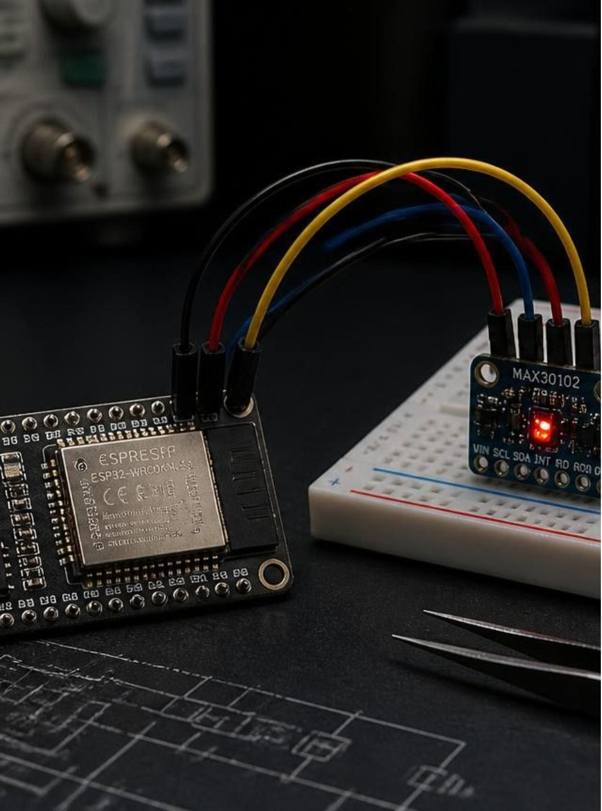
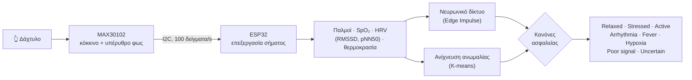
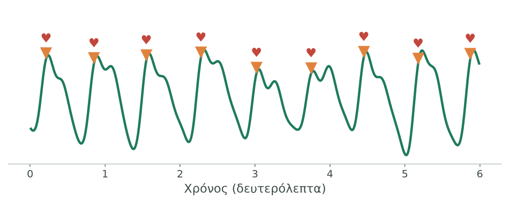
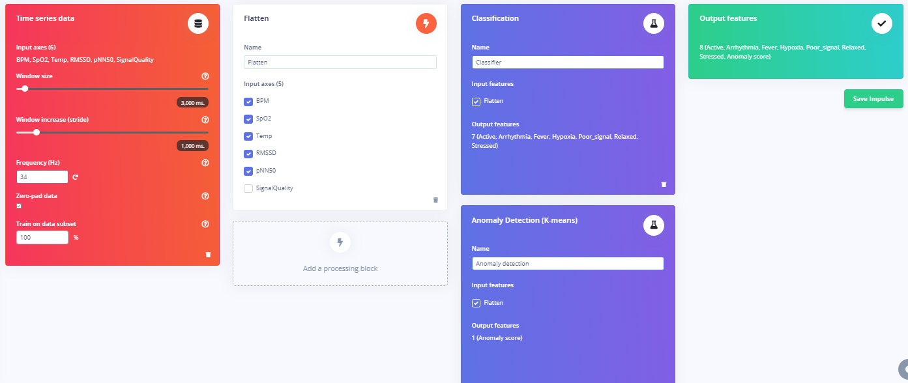
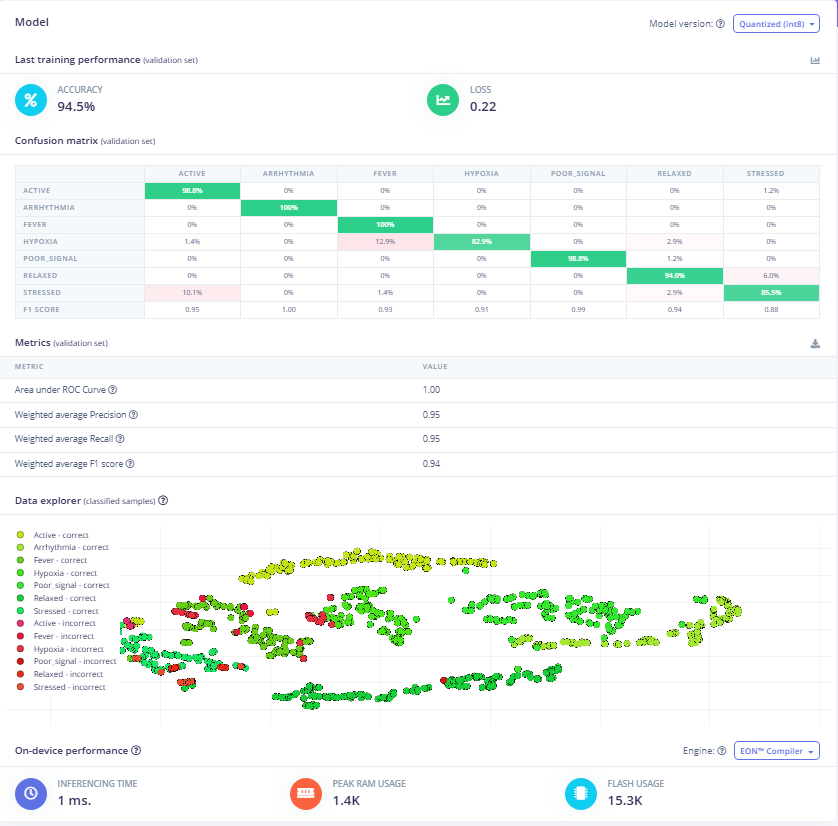
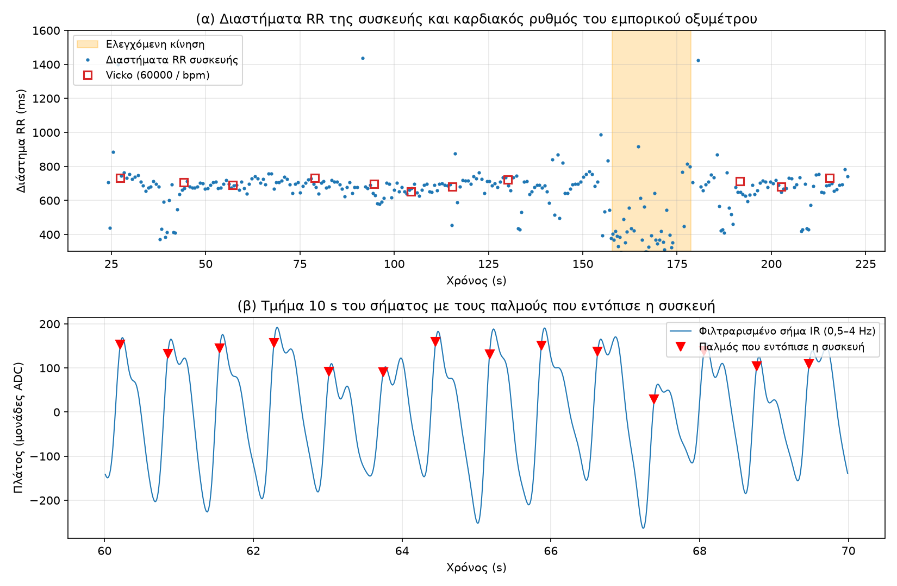
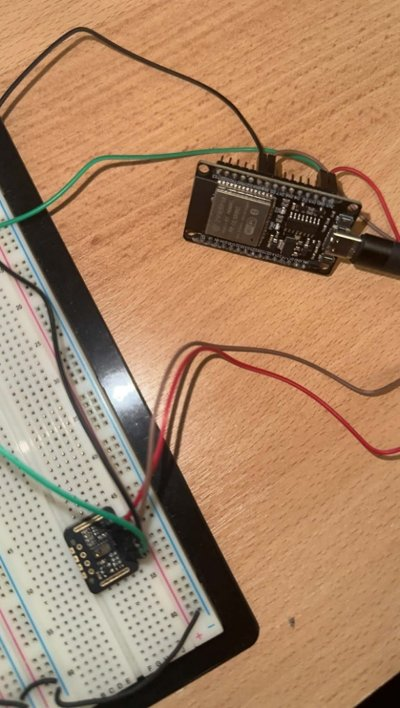

<h1 align="center">Smart Health Guardian</h1>

<p align="center">
  <b>Σύστημα IoT χαμηλού κόστους για ανάλυση ζωτικών σημάτων και ανίχνευση καταστάσεων υγείας με TinyML</b>
</p>

<p align="center">
  
  
  
  
  
</p>

<p align="center">
  
</p>

Μια μικρή συσκευή που, με το δάχτυλο πάνω στον αισθητήρα, μετρά **παλμούς, οξυγόνο και μεταβλητότητα του καρδιακού
ρυθμού**, και με ένα μικρό νευρωνικό δίκτυο **μέσα στην ίδια τη συσκευή, χωρίς internet**, εκτιμά την κατάσταση του
χρήστη: ήρεμος, αγχωμένος, σε άσκηση κ.λπ. Όταν δεν είναι σίγουρη, λέει **«δεν ξέρω»** αντί να μαντέψει.

Διπλωματική εργασία, Τμήμα Μηχανικών Παραγωγής και Διοίκησης, Διεθνές Πανεπιστήμιο της Ελλάδος, Θεσσαλονίκη 2026.
Επιβλέπων: Χρήστος Άνδρας.

> [!IMPORTANT]
> Ερευνητικό πρωτότυπο (proof-of-concept). **Δεν είναι ιατρική συσκευή** και τα αποτελέσματά του δεν αποτελούν διάγνωση.

---

## Με μια ματιά

| | |
|---|---|
| 💓 **Καρδιακός ρυθμός** | μέση διαφορά **−0,2 bpm** από εμπορικό οξύμετρο |
| 🩸 **Οξυγόνο (SpO₂)** | μέση διαφορά **−0,2%** από εμπορικό οξύμετρο |
| 🧠 **Ταξινόμηση σε ηρεμία** | **0 ψευδείς** παθολογικές ενδείξεις (πριν τις διορθώσεις: 82 στις 111) |
| ⚡ **Χρόνος απόφασης** | **≈ 1,3 ms** μέσα στον ESP32 |
| 💾 **Μνήμη** | 377 KB Flash (28%) · 28 KB RAM (8%) |
| 📶 **Internet** | δεν χρειάζεται: όλη η ανάλυση γίνεται στη συσκευή |

---

## Πώς λειτουργεί



### 1. Το φως «βλέπει» την καρδιά

Σε κάθε χτύπο φτάνει λίγο περισσότερο αίμα στο δάχτυλο, που απορροφά φως. Ο αισθητήρας μετρά το φως που επιστρέφει
(φωτοπληθυσμογραφία, PPG). Παρακάτω είναι το **πραγματικό σήμα της συσκευής**: κάθε κορυφή είναι ένας χτύπος.

<p align="center"></p>

Από αυτό το σήμα, ένας **ανιχνευτής παλμών που αναπτύχθηκε στο πλαίσιο της εργασίας** (φίλτρο ζώνης 0,5–4 Hz,
χρονισμός στο σημείο της πιο απότομης ανόδου με ακρίβεια < 10 ms) υπολογίζει παλμούς, SpO₂ και μεταβλητότητα του
καρδιακού ρυθμού (HRV).

### 2. Η τεχνητή νοημοσύνη

Κάθε δευτερόλεπτο η συσκευή παίρνει τις μετρήσεις των τελευταίων 3 δευτερολέπτων, κρατά τον μέσο όρο 5 τιμών και τις
δίνει σε ένα μικρό νευρωνικό δίκτυο (5 → 40 → 20 → 7). Παράλληλα, ένας έλεγχος ανωμαλίας (K-means, 32 ομάδες) μετρά
πόσο «γνώριμη» είναι η μέτρηση. Αν δεν μοιάζει με τα δεδομένα εκπαίδευσης, το αποτέλεσμα εμφανίζεται ως **Uncertain**.

<p align="center"></p>

Επειδή δεν είναι δυνατόν να προκληθεί αρρυθμία ή χαμηλό οξυγόνο σε άνθρωπο, το μοντέλο εκπαιδεύτηκε σε **συνθετικά
δεδομένα** (116.000 γραμμές σε 56 αρχεία) που φτιάχνει το [`data/generate_datasets_v2.py`](data/generate_datasets_v2.py)
με εύρη τιμών από τη βιβλιογραφία.

<table>
<tr>
<td width="50%"></td>
<td width="50%">

**Ακρίβεια του μοντέλου** (συνθετικά δεδομένα)

| Μετρική | Τιμή |
|---|---|
| Σύνολο επικύρωσης | **94,5%** |
| Σύνολο ελέγχου | 89,4% |
| Weighted F1 | 0,94 |
| Μοντέλο | float32, EON Compiler |

Τα λίγα λάθη είναι ανάμεσα σε καταστάσεις που μοιάζουν, π.χ. στρες και άσκηση, όπου και στις δύο οι παλμοί είναι ψηλοί.

</td>
</tr>
</table>

---

## Αποτελέσματα

Οι μετρήσεις έγιναν με τη συσκευή και ένα **εμπορικό οξύμετρο (Vicko)** ταυτόχρονα, με καταγραφή της ώρας κάθε ένδειξης.

<p align="center"></p>

| | Συσκευή | Οξύμετρο | Διαφορά |
|---|---|---|---|
| Καρδιακός ρυθμός (μέσος, 7 σημεία) | 86,0 bpm | 86,1 bpm | **−0,2 bpm** (μέση απόλυτη 1,9) |
| SpO₂ (μέσο, 7 σημεία) | 98,6% | 98,9% | **−0,2%** (μέγιστη 0,7%) |

<p align="center"></p>

Σε **δοκιμή ελεγχόμενης κίνησης** (το δάχτυλο κουνιέται για 20 δευτερόλεπτα) η συσκευή δεν έδωσε κανένα αποτέλεσμα όσο
υπήρχε κίνηση και μετά εμφάνισε «Uncertain»: όταν δεν είναι σίγουρη, το λέει.

### Τι «λέει» η συσκευή

Πραγματική έξοδος της τελικής έκδοσης στο Serial Monitor, με τον χρήστη σε ηρεμία:

<p align="center"></p>

---

## Τι βελτιώθηκε: από 82 λάθη σε 0

Το πρώτο πρωτότυπο, με τον χρήστη σε ηρεμία, έβγαζε «Arrhythmia» 82 φορές στις 111. Με έλεγχο του κώδικα, μετρήσεις
δίπλα σε οξύμετρο και [ανάλυση του ακατέργαστου σήματος](measurements/) βρέθηκαν τέσσερις αιτίες:

| Πρόβλημα | Λύση |
|---|---|
| 🔻 **Χάνονταν μετρήσεις**: όσο τύπωνε αποτελέσματα, χανόταν το 5–8% των δειγμάτων, οπότε οι παλμοί έβγαιναν ~5% ψηλότεροι | Μεγαλύτερη μνήμη αποστολής και διόρθωση του χρόνου: **0 απώλειες** |
| 💓 **Ανακριβής χρονισμός παλμών**: ο έτοιμος αλγόριθμος έπεφτε έξω έως ±50 ms και η ηρεμία έμοιαζε με αρρυθμία | Νέος ανιχνευτής παλμών: ρεαλιστικές τιμές HRV (RMSSD ≈ 45 ms) |
| 📊 **Πολύ «στενά» δεδομένα εκπαίδευσης**: ένας ήρεμος άνθρωπος με 88 παλμούς δεν ταίριαζε σε καμία κατηγορία | Νέο σύνολο δεδομένων v2 και επανεκπαίδευση |
| ❓ **Δεν ήξερε να πει «δεν ξέρω»**: σε άγνωστη μέτρηση έδινε τυχαία απάντηση με σιγουριά 99,6% | Έλεγχος ανωμαλίας: πάνω από 0,3 εμφανίζεται «Uncertain» |

<p align="center"></p>

---

## Υλικό και συνδεσμολογία

<table>
<tr>
<td width="62%"></td>
<td width="38%" align="center"></td>
</tr>
</table>

| MAX30102 | ESP32 DevKit |
|---|---|
| VIN | 3V3 |
| GND | GND |
| SDA | GPIO18 |
| SCL | GPIO19 |

I2C στα 400 kHz (`Wire.begin(18, 19)`). Μόνο τέσσερα καλώδια.

---

## Εγκατάσταση και ανέβασμα στον ESP32

1. **Arduino IDE** με υποστήριξη πλακετών **esp32** (Espressif) και πλακέτα **ESP32 Dev Module**.
2. **Βιβλιοθήκες**:
   - *SparkFun MAX3010x Pulse and Proximity Sensor Library* (από τον Library Manager).
   - Το μοντέλο: *Sketch → Include Library → Add .ZIP Library…* και επιλογή του zip από το [`firmware/library/`](firmware/library/).
3. Άνοιγμα του [`firmware/smart_health_guardian_v29/smart_health_guardian_v29.ino`](firmware/smart_health_guardian_v29/smart_health_guardian_v29.ino)
   και **Upload**. Σε ορισμένες πλακέτες χρειάζεται να κρατηθεί πατημένο το κουμπί **BOOT** μέχρι να ξεκινήσει το ανέβασμα.
4. **Serial Monitor** στα **115200 baud**. Με το δάχτυλο στον αισθητήρα, το πρώτο αποτέλεσμα εμφανίζεται σε περίπου
   40 δευτερόλεπτα και μετά ανανεώνεται κάθε δευτερόλεπτο.

### Αναπαραγωγή των δεδομένων

```bash
cd data
python generate_datasets_v2.py      # γράφει ξανά το data/datasets_v2/ (σταθερό seed)
```

---

## Δομή του repository

| Φάκελος | Τι περιέχει |
|---|---|
| [`firmware/smart_health_guardian_v29/`](firmware/smart_health_guardian_v29/) | **Τελικός κώδικας** (V29) για Arduino IDE |
| [`firmware/smart_health_guardian_v28/`](firmware/smart_health_guardian_v28/) | Προηγούμενη έκδοση, για σύγκριση |
| [`firmware/library/`](firmware/library/) | Βιβλιοθήκη του μοντέλου από το Edge Impulse (v1.0.9) |
| [`data/datasets_v1/`](data/datasets_v1/) | Πρώτο συνθετικό σύνολο δεδομένων (έως V28) |
| [`data/datasets_v2/`](data/datasets_v2/) | Τελικό συνθετικό σύνολο (56 αρχεία, 116.000 γραμμές) |
| [`data/generate_datasets_v2.py`](data/generate_datasets_v2.py) | Πρόγραμμα που παράγει το `datasets_v2` |
| [`measurements/`](measurements/) | Καταγραφές της συσκευής, ενδείξεις του οξυμέτρου και scripts ανάλυσης |
| [`docs/images/`](docs/images/) | Εικόνες και γραφήματα αυτού του README |

---

## Περιορισμοί

- Η αξιολόγηση έγινε σε **έναν χρήστη** και με λίγα σημεία σύγκρισης: δεν αποτελεί στατιστική ή κλινική επικύρωση.
- Το μοντέλο εκπαιδεύτηκε σε **συνθετικά δεδομένα**, όχι σε ασθενείς. Οι 94,5% αφορούν τα συνθετικά δεδομένα.
- Το **SpO₂** και η **θερμοκρασία** είναι ενδεικτικά (εμπειρική διόρθωση με ένα όργανο σύγκρισης).
- Επόμενα βήματα: δεδομένα από πολλούς ανθρώπους, σύγκριση με ηλεκτροκαρδιογράφημα (ECG), αισθητήρας κίνησης,
  οθόνη ή εφαρμογή κινητού.
