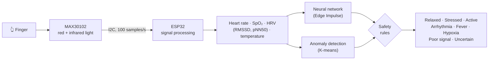
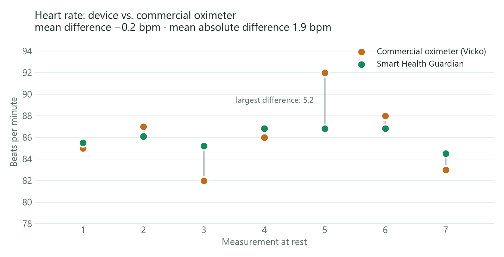
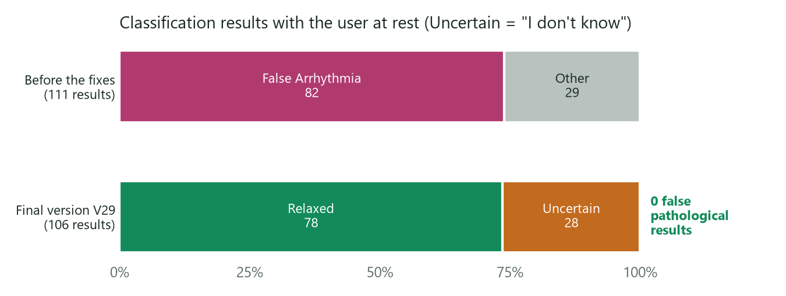
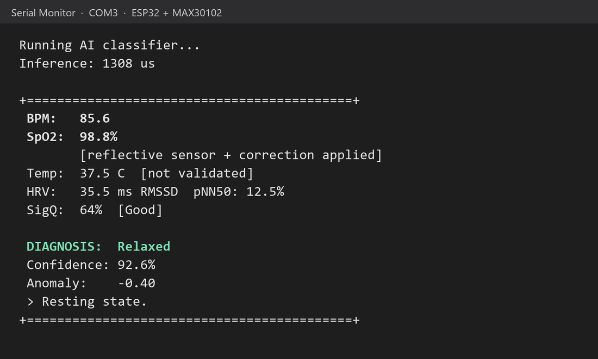
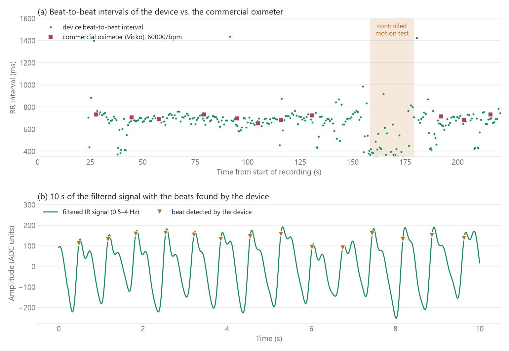
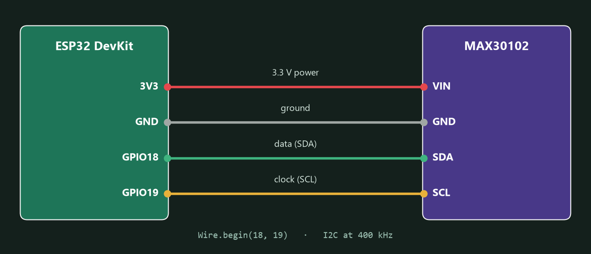

<h1 align="center">Smart Health Guardian</h1>

<p align="center">
  <b>A low-cost IoT system for vital-sign analysis and health-state detection with TinyML</b>
</p>

<p align="center">
  
  
  
  
  
</p>

<p align="center">
  
</p>

A small device that, with a finger on the sensor, measures **heart rate, blood oxygen and heart-rate variability**, and
uses a tiny neural network **running on the device itself, with no internet connection**, to estimate the user's
state: relaxed, stressed, exercising and so on. When it is not sure, it says **"I don't know"** instead of guessing.

Diploma thesis, Department of Industrial Engineering and Management, International Hellenic University,
Thessaloniki 2026.

> [!IMPORTANT]
> Research prototype (proof of concept). **It is not a medical device** and its outputs are not a diagnosis.

---

## At a glance

| | |
|---|---|
| 💓 **Heart rate** | mean difference **−0.2 bpm** from a commercial pulse oximeter |
| 🩸 **Blood oxygen (SpO₂)** | mean difference **−0.2%** from a commercial pulse oximeter |
| 🧠 **Classification at rest** | **0 false** pathological results (before the fixes: 82 out of 111) |
| ⚡ **Decision time** | **≈ 1.3 ms** on the ESP32 |
| 💾 **Memory** | 377 KB Flash (28%) · 28 KB RAM (8%) |
| 📶 **Internet** | not needed: all analysis runs on the device |

---

## How it works



### 1. Light "sees" the heart

With every heartbeat a little more blood reaches the fingertip, and blood absorbs light. The sensor measures the light
that comes back (photoplethysmography, PPG). Below is the **real signal recorded by the device**: every peak is one
heartbeat.

<p align="center"></p>

From this signal, a **beat detector developed for this project** (0.5–4 Hz band-pass filter, beat time at the
steepest point of the upstroke with < 10 ms resolution) computes heart rate, SpO₂ and heart-rate variability (HRV).

### 2. The artificial intelligence

Every second the device takes the last 3 seconds of measurements, averages 5 values and feeds them to a small neural
network (5 → 40 → 20 → 7). In parallel, an anomaly detector (K-means, 32 clusters) scores how "familiar" the
measurement is. If it does not look like the training data, the result is shown as **Uncertain**.

<p align="center"></p>

Because arrhythmia or low blood oxygen cannot be induced in a person to collect data, the model was trained on
**synthetic data** (116,000 rows in 56 files) produced by [`data/generate_datasets_v2.py`](data/generate_datasets_v2.py)
with value ranges taken from the literature.

<table>
<tr>
<td width="50%"></td>
<td width="50%">

**Model accuracy** (synthetic data)

| Metric | Value |
|---|---|
| Validation set | **94.5%** |
| Test set | 89.4% |
| Weighted F1 | 0.94 |
| Model | float32, EON Compiler |

The few errors are between similar states, e.g. stress and exercise, where heart rate is high in both.

</td>
</tr>
</table>

---

## Results

The device and a **commercial pulse oximeter (Vicko)** were used at the same time, and the time of every oximeter
reading was logged.

<p align="center"></p>

| | Device | Oximeter | Difference |
|---|---|---|---|
| Heart rate (mean of 7 points) | 86.0 bpm | 86.1 bpm | **−0.2 bpm** (mean absolute 1.9) |
| SpO₂ (mean of 7 points) | 98.6% | 98.9% | **−0.2%** (max 0.7%) |

<p align="center"></p>

In a **controlled motion test** (the finger moved on the sensor for 20 seconds) the device gave no result while the
motion lasted and then showed "Uncertain": when it is not sure, it says so.

### What the device "says"

Real output of the final version in the Serial Monitor, with the user at rest:

<p align="center"></p>

---

## What was improved: from 82 errors to 0

With the user at rest, the first prototype reported "Arrhythmia" 82 times out of 111. Code review, measurements next
to an oximeter and an [analysis of the raw sensor signal](measurements/) revealed four causes:

| Problem | Fix |
|---|---|
| 🔻 **Samples were lost**: while printing results, 5–8% of the samples were dropped, so heart rate came out ~5% too high | Larger serial transmit buffer and time correction: **0 lost samples** |
| 💓 **Inaccurate beat timing**: the stock detector was off by up to ±50 ms, so rest looked like arrhythmia | New beat detector: realistic HRV values (RMSSD ≈ 45 ms) |
| 📊 **Training data too narrow**: a relaxed person with 88 bpm did not fit any class | New dataset v2 and retraining |
| ❓ **It could not say "I don't know"**: for an unfamiliar input it gave a random answer with 99.6% confidence | Anomaly check: above 0.3 the result is shown as "Uncertain" |

<p align="center"></p>

---

## Hardware and wiring

<table>
<tr>
<td width="62%"></td>
<td width="38%" align="center"></td>
</tr>
</table>

| MAX30102 | ESP32 DevKit |
|---|---|
| VIN | 3V3 |
| GND | GND |
| SDA | GPIO18 |
| SCL | GPIO19 |

I2C at 400 kHz (`Wire.begin(18, 19)`). Just four wires.

---

## Setup and upload to the ESP32

1. **Arduino IDE** with the **esp32** board package (Espressif) and the **ESP32 Dev Module** board.
2. **Libraries**:
   - *SparkFun MAX3010x Pulse and Proximity Sensor Library* (from the Library Manager).
   - The model: *Sketch → Include Library → Add .ZIP Library…* and select the zip in [`firmware/library/`](firmware/library/).
3. Open [`firmware/smart_health_guardian_v29/smart_health_guardian_v29.ino`](firmware/smart_health_guardian_v29/smart_health_guardian_v29.ino)
   and click **Upload**. On some boards the **BOOT** button must be held until the upload starts.
4. **Serial Monitor** at **115200 baud**. With a finger on the sensor, the first result appears after about
   40 seconds and is then refreshed every second.

### Reproducing the data

```bash
cd data
python generate_datasets_v2.py      # rewrites data/datasets_v2/ (fixed random seed)
```

---

## Repository layout

| Folder | Contents |
|---|---|
| [`firmware/smart_health_guardian_v29/`](firmware/smart_health_guardian_v29/) | **Final firmware** (V29) for the Arduino IDE |
| [`firmware/smart_health_guardian_v28/`](firmware/smart_health_guardian_v28/) | Previous version, for comparison |
| [`firmware/library/`](firmware/library/) | Edge Impulse model library (v1.0.9) |
| [`data/datasets_v1/`](data/datasets_v1/) | First synthetic dataset (up to V28) |
| [`data/datasets_v2/`](data/datasets_v2/) | Final synthetic dataset (56 files, 116,000 rows) |
| [`data/generate_datasets_v2.py`](data/generate_datasets_v2.py) | Script that generates `datasets_v2` |
| [`measurements/`](measurements/) | Device logs, oximeter readings and analysis scripts |
| [`docs/images/`](docs/images/) | Images and charts used in this README |

---

## Limitations

- The evaluation used **one person** and few comparison points: it is not a statistical or clinical validation.
- The model was trained on **synthetic data**, not on patients. The 94.5% refers to synthetic data.
- **SpO₂** and **temperature** are indicative only (empirical correction against a single reference device).
- Next steps: data from many people, comparison with an electrocardiogram (ECG), a motion sensor, and a display or
  phone app.
